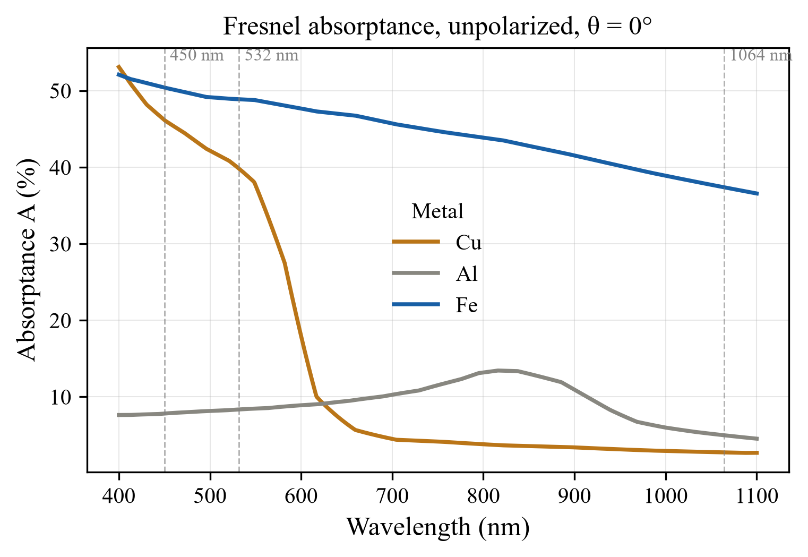
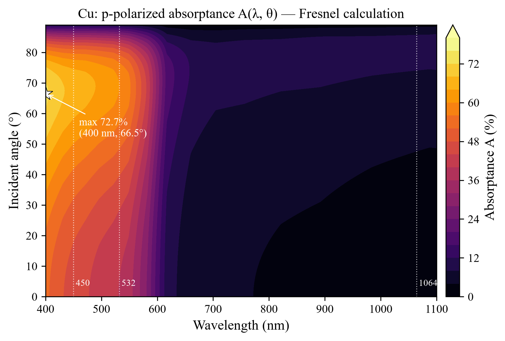

# Laser Absorption Explorer


> 基于**菲涅尔方程（Fresnel Equations）与复折射率**，从第一性光学原理出发计算金属材料对激光的吸收率，系统探究**波长**与**入射角**两大维度的影响——以铜（Cu）为核心案例，兼及铝（Al）与铁（Fe）。

为什么铜值得专门研究？因为它在 1064 nm（主流光纤激光波长）下的理论吸收率**仅约 2.7%**——95% 以上的能量被反射回去，这正是新能源电池、电机发卡（hairpin）焊接中飞溅、气孔、回返光损伤激光器的物理根源。而换到 532 nm 绿光，吸收率跳升至约 **40%**。本项目用 100 行纯 numpy 代码把这背后的物理完整地算出来、画出来。

## Features

- 纯物理内核：斜入射复菲涅尔方程，支持 s / p / 非偏振三种偏振态，波长轴与角度轴自动广播
- 公开数据驱动：自动解析 [refractiveindex.info](https://refractiveindex.info) 数据库（CC0）的 nk 数据
- 发表级图表：Times/STIX 字体、300 DPI、PNG + PDF 矢量双输出
- 波长-角度二维热力图，自动标注伪布儒斯特吸收全局最大值
- 11 项 pytest 单元测试：对称性、解析对拍、物理约束、文献数值锚点四层验证

## Results at a Glance

| λ (nm) | Cu | Al | Fe | 备注 |
|---|---|---|---|---|
| 450（蓝光） | 46.2% | 7.8% | 50.4% | Cu 进入 d 带带间跃迁区 |
| 532（绿光） | 39.8% | 8.4% | 48.9% | 绿光焊铜的物理基础 |
| 808（半导体） | 3.7% | 13.3% | 43.7% | Al 带间跃迁小峰区 |
| 1064（光纤） | **2.74%** | 4.98% | 37.4% | 文献范围 2–5%，通过验证 |





热力图（p 偏振）显示：高吸收带集中在**短波长 × 掠入射**叠加区，全局最大值 **72.7% @ (400 nm, 66.5°)**——"短波长 + 斜入射"双增益策略的直观可视化。

## Physics

### 1. 复菲涅尔方程

金属的光学响应由复折射率 $N = n + i\kappa$ 描述，复介电函数为

$$\varepsilon = N^2 = (n^2 - \kappa^2) + i\,2n\kappa$$

光从空气斜入射到金属表面（入射角 $\theta$），引入中间量 $u = N_2\cos\theta_t = \sqrt{\varepsilon - \sin^2\theta}$（复数），两个偏振本征态的振幅反射系数为

$$r_s = \frac{\cos\theta - u}{\cos\theta + u}, \qquad r_p = \frac{\varepsilon\cos\theta - u}{\varepsilon\cos\theta + u}$$

金属在可见—近红外波段不透明（透射率 $T \approx 0$），能量守恒给出吸收率

$$A_{s,p} = 1 - |r_{s,p}|^2, \qquad A_{\text{unpol}} = \tfrac{1}{2}(A_s + A_p)$$

垂直入射时退化为教科书解析式（本项目用它做单元测试的对拍基准）：

$$A(0°) = \frac{4n}{(n+1)^2 + \kappa^2}$$

注意 $\kappa^2$ 出现在分母：$\kappa$ 越大，自由电子受迫振动再辐射（即反射）越强——这就是红外端铜"怎么照都照不进去"的数学表达。

### 2. d 带带间跃迁：~590 nm 的物理悬崖

红外端与绿光端吸收率的巨大差异，**无法**用经典的 Drude 自由电子模型解释（Hagen–Rubens 关系只给出随 $1/\sqrt{\lambda}$ 的平缓变化）。真正的机制在能带论：

- 铜的 3d 带（全满）位于费米面以下约 **2.1 eV** 处，对应阈值波长 $\lambda_c = hc/2.1\,\text{eV} \approx 590\,\text{nm}$；
- 当 $h\nu < 2.1$ eV（波长 > 590 nm），光子只能驱动自由电子（Drude 通道）→ 强反射、弱吸收；
- 当 $h\nu > 2.1$ eV（波长 < 590 nm，即蓝绿光），**d 带电子被直接激发到导带（带间跃迁通道打开）**，光子能量被真实地沉积进材料。

这条"物理悬崖"在计算的吸收率曲线中清晰可见（上图 Cu 曲线在 590 nm 附近的陡降边沿）——它就是蓝光/绿光激光焊铜这一整条产业技术路线的物理地基。

### 3. 伪布儒斯特角（Pseudo-Brewster Angle）

电介质存在布儒斯特角（$r_p = 0$）；金属因为有强吸收（$\kappa \neq 0$），$r_p$ 不会归零，但在 60°–85° 掠入射区出现一个**反射率深谷（即吸收率峰值）**，称为伪布儒斯特角。其机制是：斜入射时 p 偏振电场垂直分量与反射波发生相位变化，部分反射光振幅相消，使净反射下降。

- 对 Cu @ 1064 nm：$A_p$ 从正入射的 2.7% 升至 **9.7% @ 82°**——纯靠角度调制即可获得 3.5 倍增益；
- 叠加短波长本底吸收后，热力图给出全局最大 **72.7% @ (400 nm, 66.5°)**。

这解释了激光加工中"掠入射切割前沿耦合增强"的现象，也为高反材料的能量耦合策略提供了定量依据。

## Installation & Usage

```bash
# 1. 克隆仓库
git clone https://github.com/YOUR_USERNAME/laser-absorption.git
cd laser-absorption

# 2. 安装依赖（建议使用虚拟环境）
python -m pip install -r requirements.txt
```

```bash
# 3. 复现 README 中的两张主图（输出至 output/，PNG 300DPI + PDF 矢量）
python src/generate_spectrum.py
python src/generate_heatmap.py

# 4. 一段式快速上手（在你的代码中调用）
```

```python
from material_optics import MaterialOptics

cu = MaterialOptics.from_yaml("Cu", "data/Cu_Johnson.yml")
print(cu.absorptance_normal(1064.0))       # 0.0274 —— 正入射
print(cu.absorptance(1064.0, theta=70.0,   # 斜入射 p 偏振
                     polarization="p"))
```

## Testing

物理内核由四层共 11 项测试保护：

```bash
python -m pytest tests/ -v
```

| 层级 | 验证内容 |
|---|---|
| 对称性 | θ=0° 时 s 与 p 偏振严格相等（rtol=1e-12） |
| 解析对拍 | 数值结果还原 A = 4n/[(n+1)²+κ²] |
| 物理约束 | 全网格 0 ≤ A ≤ 1；非偏振 = 偏振平均 |
| 文献锚点 | Cu@1064 nm ∈ 2–5%；A(532)/A(1064) > 10 |

## Project Structure

```
laser-absorption/
├── data/                          # refractiveindex.info nk 数据（CC0）
├── src/
│   ├── material_optics.py         # MaterialOptics 类 + 纯函数菲涅尔内核
│   ├── angle_sweep.py             # AngleSweep 类 + AngleSweepResult
│   ├── plotter.py                 # Plotter 类（发表级图表）
│   ├── generate_spectrum.py       # 复现正入射光谱图
│   └── generate_heatmap.py        # 复现二维热力图
├── tests/test_fresnel.py          # 11 项 pytest 单元测试
├── output/                        # 生成的图表（PNG + PDF）
└── .github/workflows/ci.yml       # GitHub Actions CI
```

## References

1. P. B. Johnson and R. W. Christy, "Optical constants of the noble metals," *Phys. Rev. B* **6**, 4370–4379 (1972). —— Cu 数据来源
2. P. B. Johnson and R. W. Christy, "Optical constants of transition metals," *Phys. Rev. B* **9**, 5056–5070 (1974). —— Fe 数据来源
3. A. D. Rakić, "Algorithm for the determination of intrinsic optical constants of metal films: application to aluminum," *Appl. Opt.* **34**, 4755–4767 (1995). —— Al 数据来源
4. [refractiveindex.info](https://refractiveindex.info) database（E. D. Palik 手册数据的在线公开版本，CC0 公有领域）
5. W. M. Steen and J. Mazumder, *Laser Material Processing*, 4th ed., Springer (2010). —— 加工背景

## License

代码部分以 [MIT License](LICENSE) 发布。`data/` 目录中的光学常数来自 refractiveindex.info 数据库，为 **CC0 公有领域**（引用时请注明上表原始文献）。
